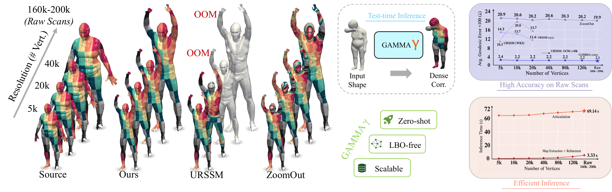

# GAMMA: Geometry-Grounded Articulation and Test-Time Adaptation for Zero-Shot, Scalable Shape Matching in the Wild

[](https://liu-qilong.github.io/GAMMA/)
[](https://github.com/liu-qilong/GAMMA)
[](https://arxiv.org/abs/2606.29167)

**Qilong Liu**<sup>1,\*</sup>, **Qinfeng Xiao**<sup>1,\*</sup>, **Chenyuan Yi**<sup>1</sup>, **Yongsheng Lin**<sup>1</sup>, **Liying Zhang**<sup>1</sup>, **Kit-lun Yick**<sup>1,2,†</sup>

<sup>1</sup>Hong Kong Polytechnic University, HK SAR<br>
<sup>2</sup>Artificial Intelligence in Design, HK SAR<br>
<sup>*</sup>Equal contribution. <sup>†</sup>Corresponding author.

Official implementation of **GAMMA**.



## Abstract

Dense correspondence on in-the-wild 3D scans must handle severe non-isometric deformation, partial observations, topology artifacts, irregular discretization, and extreme resolution. Together, these conditions make shape matching both a robustness and scalability problem. Existing methods typically handle only part of this regime and often require expensive spectral or dense feature processing, repeated pairwise optimization, or dataset-specific training. To address the above issues, we present GAMMA, a zero-shot framework based on Geometry-Grounded Articulation. For each scan, GAMMA renders multiple views and uses a pretrained estimator with a category-specific parametric model to produce one template estimate per view. Because these estimates share a fixed vertex ordering, confidence-weighted consensus fuses them into one canonical template and establishes sparse matches across scans. We refine these matches on the input geometry to recover accurate dense correspondences. All core matching steps run at inference time and require neither target-dataset correspondence training nor costly Laplace–Beltrami operator (LBO) computation on the input scans. Each fused template is cached, so additional pair queries reuse the canonicalization. GAMMA obtains average geodesic errors of 2.9 on TOPKIDS and 2.4 on remeshed SMAL, reducing error relative to URSSM by 67% and 60%, respectively. Complementary evaluations report lower aggregate errors than the evaluated baselines on BeCoS-processed partial subsets and demonstrate stable matching accuracy from decimated FAUST meshes to raw scans with 160k–200k vertices. These results demonstrate accurate correspondence across complementary settings and collection-level scalability after per-shape caching.

## Results at a glance

Mean geodesic error ×100 (lower is better), before optional spectral refinement:

| Curated benchmark | SMAL | TOPKIDS | FAUST | SCAPE | SHREC19 |
| --- | ---: | ---: | ---: | ---: | ---: |
| GAMMA | 2.4 | 2.9 | 1.5 | 1.8 | 3.0 |

| BeCoS subset | FAUST P-F | FAUST P-P | KIDS P-F | KIDS P-P |
| --- | ---: | ---: | ---: | ---: |
| GAMMA | 2.7 | 3.3 | 6.7 | 5.4 |

| Raw FAUST resolution | 5k | 10k | 20k | 40k | 80k | 120k | Raw |
| --- | ---: | ---: | ---: | ---: | ---: | ---: | ---: |
| GAMMA | 2.42 | 2.25 | 2.18 | 2.16 | 2.16 | 2.13 | 2.11 |

The raw-FAUST table uses a **template-domain** metric, distinct from the curated/partial target-domain metric. At raw resolution (160k–200k vertices), cached composition takes about **3.33 seconds per directed pair** after approximately **69.1 seconds of articulation per shape**. Processing 20 shapes and 400 queries takes about **45.3 minutes**, versus **666 minutes** for chunked ZoomOut. See the [project page](https://liu-qilong.github.io/GAMMA/) and [paper](https://arxiv.org/abs/2606.29167) for full comparisons and evaluation protocols.

## Reproduction guide

1. [Environment and checkpoints](#environment-and-checkpoints)
2. [Curated benchmarks](#curated-benchmarks)
3. [High-resolution raw FAUST](#high-resolution-raw-faust)
4. [BeCoS partial matching](#becos-partial-matching)
5. [Outputs and visualization](#outputs-and-visualization)

The main pipeline uses SAM 3D Body/MHR for humans and PRIMA/SMAL for animals. Articulation fits and caches one proxy per shape; matching reuses those proxies for directed shape pairs. No correspondence model is trained on the target benchmark. Spectral ICP and ZoomOut are optional refinements, reported separately in the paper.

### Environment and checkpoints

Use Linux with an NVIDIA GPU, a compatible driver, CUDA Toolkit 12.4, [UV](https://docs.astral.sh/uv/), and Conda for the separately managed PRIMA and BeCoS environments. The root UV environment uses Python 3.11 and PyTorch 2.5.1/CUDA 12.4. GPU memory requirements depend on scan resolution and batch settings; a minimum VRAM requirement has not been established.

Install CUDA 12.4 at `/usr/local/cuda-12.4`, as expected by the Detectron2 build configuration. On Ubuntu 22.04 x86-64, the toolkit setup used in this project is:

```bash
cd /tmp
wget https://developer.download.nvidia.com/compute/cuda/repos/ubuntu2204/x86_64/cuda-keyring_1.1-1_all.deb
sudo dpkg -i cuda-keyring_1.1-1_all.deb
sudo apt-get update
sudo apt-get install -y cuda-toolkit-12-4
```

Clone the project and create its environment:

```bash
git clone https://github.com/liu-qilong/GAMMA.git
cd GAMMA
uv sync --locked --python 3.11
```

All subsequent commands run from the repository root unless enclosed in a subshell that changes directory. Model weights and datasets are downloaded separately under their providers’ terms.

#### Human estimator: SAM 3D Body

```bash
mkdir -p pkg
git clone https://github.com/facebookresearch/sam-3d-body.git pkg/sam_3d_body
git -C pkg/sam_3d_body checkout --detach 3468000660b16c2670503cfe685e6792b36d1ad6
```

The root UV environment supplies this branch’s dependencies. Request access to [SAM 3D Body DINOv3 weights](https://huggingface.co/facebook/sam-3d-body-dinov3), then download the complete model folder into `pkg/sam_3d_body/checkpoints/sam-3d-body-dinov3/`. Preserve its layout, including `model.ckpt`, `model_config.yaml`, and `assets/mhr_model.pt`.

#### Animal estimator: PRIMA

PRIMA uses its own Python 3.10 environment. Its Conda environment bootstraps installation; the runtime interpreter is `pkg/PRIMA/.venv/bin/python`.

```bash
mkdir -p pkg
git clone https://github.com/AdaptiveMotorControlLab/PRIMA.git pkg/PRIMA
git -C pkg/PRIMA checkout --detach 0c4251ec8ab03302a2305c02d926d1cf353f9a35
conda create -n prima python=3.10 -y
(
  source "$(conda info --base)/etc/profile.d/conda.sh"
  conda activate prima
  cd pkg/PRIMA
  PRIMA_PYTHON="$CONDA_PREFIX/bin/python" PRIMA_VENV=.venv ./scripts/clean_install_local.sh
  .venv/bin/python -m pip install 'gradio>=5.1,<6' 'huggingface-hub>=0.34,<1' pyvista==0.46.4
  .venv/bin/python -m pip install --only-binary=:all: rtree
  .venv/bin/python scripts/setup_demo_data.py --hf-repo-id MLAdaptiveIntelligence/PRIMA
)
```

The required assets include:

```text
pkg/PRIMA/data/
├── PRIMAS1/.hydra/config.yaml
├── PRIMAS1/checkpoints/s1ckpt_inference.ckpt
└── smal/
```

Allow network access on the first articulation run to cache BioCLIP (`imageomics/bioclip`) and the Detectron2 detector weights. Once BioCLIP is cached, prefix PRIMA commands with `HF_HUB_OFFLINE=1` to skip Hugging Face metadata requests. Matching the saved animal proxies uses the root UV environment.

### Curated benchmarks

Obtain the remeshed FAUST, SCAPE, SHREC19, TOPKIDS, and SMAL benchmark data from [URSSM](https://github.com/dongliangcao/Unsupervised-Learning-of-Robust-Spectral-Shape-Matching), respecting the original dataset licenses. Extract the dataset folders into:

```text
data/shape-corr/
├── FAUST_r/
├── SCAPE_r/
├── SHREC19_r/
├── TOPKIDS/
└── SMAL_r/
```

_P.S. The original download link from URSSM's repo seem to be invalid. I've uploaded a copy to [here](https://huggingface.co/liu-qilong/shape-corr-urssm). All credits belong to the original authors._

Preserve each dataset’s full layout, including `off/` meshes, `corres/` ground truth, and split metadata (such as SMAL’s `train_cat.txt` and `test_cat.txt`). Evaluation also needs `dist/` geodesic matrices. If the archive lacks this repository’s preprocessed `.npz` assets, prepare them with:

```bash
for dataset in FAUST_r SCAPE_r SHREC19_r TOPKIDS SMAL_r; do
  uv run python utils/fmap/preprocess.py --data_root "data/shape-corr/${dataset}" --k_eig 200
done
```

This utility also writes `spectral/` assets for optional spectral refinement and texture visualization. The primary curated matcher reads the meshes directly and does not require an input LBO eigenbasis. Preprocessing and evaluation assets are distinct from the matching algorithm.

_P.S. The data preprocessing script was adapted from URSSM but the storage scheme was different. If you have downloaded the data from URSSM and run the preprocessing, you will need to redo the data preprocessing on a clean copy of the data._

#### Human articulation

FAUST evaluation uses the 20 test shapes selected by `_08` and `_09`:

```bash
for filename_filter in _08 _09; do
  uv run python articulate/run.py --config-name uncertainty_aware_parallel \
    shape_dir=data/shape-corr/FAUST_r/off \
    out_dir=output/faust_r_uncertainty \
    shape_refiner.trim_mesh=false \
    shape_loader.filename_filter="${filename_filter}"
done

uv run python articulate/run.py --config-name uncertainty_aware_parallel \
  shape_dir=data/shape-corr/SCAPE_r/off \
  out_dir=output/scape_r_uncertainty \
  shape_refiner.trim_mesh=false

uv run python articulate/run.py --config-name uncertainty_aware_parallel \
  shape_dir=data/shape-corr/SHREC19_r/off \
  out_dir=output/shrec19_r_uncertainty \
  shape_refiner.trim_mesh=false

uv run python articulate/run.py --config-name uncertainty_aware_parallel \
  shape_dir=data/shape-corr/TOPKIDS/off \
  out_dir=output/topkids_uncertainty \
  view_sampler.axis_order=yzx \
  shape_refiner.n_views_surface=0 \
  shape_refiner.trim_mesh=false
```

Evaluate each dataset using its matching preset:

```bash
for item in faust_r:FAUST_r scape_r:SCAPE_r shrec19_r:SHREC19_r topkids:TOPKIDS; do
  preset="${item%%:*}"
  dataset="${item##*:}"
  uv run python match/run.py --config-name partial_aware \
    data="${preset}" \
    data.data_root="data/shape-corr/${dataset}" \
    data.articulated_shape_dir="output/${preset}_uncertainty" \
    map_extractor.use_reciprocal_consistency=true \
    out_dir="output/${preset}_uncertainty"
done
```

#### Animal articulation and matching

The paper’s animal results use PRIMA:

```bash
pkg/PRIMA/.venv/bin/python -u articulate/run.py --config-name uncertainty_aware_prima \
  shape_dir=data/shape-corr/SMAL_r/off \
  out_dir=output/smal_r_prima_uncertainty

uv run python match/run.py --config-name partial_aware_smal \
  data=smal_r \
  data.data_root=data/shape-corr/SMAL_r \
  data.articulated_shape_dir=output/smal_r_prima_uncertainty \
  out_dir=output/smal_r_prima_uncertainty
```

#### Optional spectral refinement

Reuse the same saved articulations. These variants require the spectral assets and correspond to the separate `+Spec.-ICP` and `+ZoomOut` rows in the paper:

```bash
for refinement in spectral-icp zoomout; do
  for item in faust_r:FAUST_r scape_r:SCAPE_r shrec19_r:SHREC19_r topkids:TOPKIDS; do
    preset="${item%%:*}"
    dataset="${item##*:}"
    uv run python match/run.py --config-name partial_aware_spectral \
      data="${preset}" \
      data.data_root="data/shape-corr/${dataset}" \
      data.articulated_shape_dir="output/${preset}_uncertainty" \
      map_extractor.use_reciprocal_consistency=true \
      map_extractor.refinement_method="${refinement}" \
      out_dir="output/${preset}_${refinement}"
  done
  uv run python match/run.py --config-name partial_aware_smal_spectral \
    data=smal_r \
    data.data_root=data/shape-corr/SMAL_r \
    data.articulated_shape_dir=output/smal_r_prima_uncertainty \
    map_extractor.refinement_method="${refinement}" \
    out_dir="output/smal_r_prima_${refinement}"
done
```

### High-resolution raw FAUST

Download [MPI-FAUST](https://faust-leaderboard.is.tuebingen.mpg.de). Place the training archive’s `scans/` and `registrations/` folders under `data/shape-original/faust_raw/`. Keep all 100 scans and their registrations; articulation and evaluation below select the 20-shape test split.

Generate the six decimated resolutions (vertex counts are approximate):

```bash
for resolution in 5k:5000 10k:10000 20k:20000 40k:40000 80k:80000 120k:120000; do
  suffix="${resolution%%:*}"
  vertex_count="${resolution##*:}"
  uv run python utils/faust_raw/batch_decimate.py \
    --mesh_dir data/shape-original/faust_raw/scans \
    --mesh_extensions .ply \
    --out_dir "data/shape-original/faust_${suffix}/scans" \
    --decimation "${vertex_count}"
done
```

Export scan-to-template ground truth and prepare evaluation assets. Every resolution uses the same registration meshes. Raw scans are PLY; decimated scans are OBJ.

```bash
for suffix in 5k 10k 20k 40k 80k 120k raw; do
  mesh_type=obj
  if [ "${suffix}" = raw ]; then mesh_type=ply; fi
  uv run python utils/faust_raw/export_s2t.py \
    --raw_mesh_folder "data/shape-original/faust_${suffix}/scans" \
    --raw_mesh_type "${mesh_type}" \
    --regist_mesh_folder data/shape-original/faust_raw/registrations \
    --export_folder "data/shape-original/faust_${suffix}"
  uv run python utils/faust_raw/preprocess.py \
    --raw_mesh_folder "data/shape-original/faust_${suffix}/scans" \
    --raw_mesh_type "${mesh_type}" \
    --regist_mesh_folder data/shape-original/faust_raw/registrations \
    --regist_mesh_type ply \
    --output_dir "data/shape-original/faust_${suffix}" \
    --k_eig 200
done
```

The exporter writes zero-based indices in `s2t/*.txt`. The preprocessor writes `dist/template_dist.npz` and also computes `spectral/*.npz`. This supplied preprocessing path bundles spectral assets with evaluation preparation; it is not an LBO requirement of GAMMA’s primary matcher. The raw matching preset loads mass data but disables eigenvector loading.

Articulate the test shapes, then evaluate the same 400 directed pair queries at each resolution:

```bash
for suffix in 5k 10k 20k 40k 80k 120k raw; do
  for filename_filter in _08 _09; do
    uv run python articulate/run.py --config-name uncertainty_aware_parallel \
      shape_dir="data/shape-original/faust_${suffix}/scans" \
      out_dir="output/faust_${suffix}" \
      shape_refiner.trim_mesh=false \
      shape_loader.filename_filter="${filename_filter}"
  done
  mesh_type=obj
  if [ "${suffix}" = raw ]; then mesh_type=ply; fi
  uv run python match/run.py --config-name partial_aware_faust_raw_parallel \
    data.data_root="data/shape-original/faust_${suffix}" \
    data.raw_mesh_extension="${mesh_type}" \
    data.articulated_shape_dir="output/faust_${suffix}" \
    map_extractor.use_reciprocal_consistency=true \
    out_dir="output/faust_${suffix}"
done
```

Raw-FAUST evaluation uses **template-domain** mean geodesic error ×100. Compare its numbers within the raw-resolution table, not directly against the curated benchmarks’ target-domain errors.

### BeCoS partial matching

Use BeCoS to generate the FAUST and KIDS partial-to-full (P-F) and partial-to-partial (P-P) subsets. Dataset generation runs in its own Python 3.8 environment:

```bash
mkdir -p pkg data/shape-becos
git clone https://github.com/NafieAmrani/becos-code.git pkg/becos-code
git -C pkg/becos-code checkout --detach 9fe938335458d92a03c43db7604fc5ef9c7c7570
conda create -n becos python=3.8 -y
(
  cd pkg/becos-code
  conda run -n becos python -m pip install -r requirements.txt
  cp ../../utils/becos/faust.yaml ../../utils/becos/faust_partial_full.yaml ../../utils/becos/faust_partial_partial.yaml config/
  cp ../../utils/becos/kids.yaml ../../utils/becos/kids_partial_full.yaml ../../utils/becos/kids_partial_partial.yaml config/
  cp ../../utils/becos/templates_kids.csv config/
  cp ../../utils/becos/shape_dataset.py datasets/
  mkdir -p data
  ln -sfnT "$(realpath ../../data/shape-original/faust_raw/registrations)" data/faust_regist
)
```

The FAUST registrations come from the raw-FAUST preparation above. Download and extract [KIDS](https://cvg.cit.tum.de/_media/spezial/bib/kids.zip) so that `pkg/becos-code/data/KIDS/off/` contains its meshes. The KIDS P-F configuration uses `0001.null.0` as its full template.

Generate each subset from the BeCoS checkout, preserving the provided seed and splits:

```bash
(
  cd pkg/becos-code
  for dataset in faust kids; do
    for mode in partial_full partial_partial; do
      conda run --no-capture-output -n becos python main.py --config "${dataset}_${mode}"
      mv "output/${mode}" "../../data/shape-becos/${dataset}_${mode}"
    done
  done
)
```

Use fresh destination directories when generating subsets. Return to the root UV environment for articulation and matching:

```bash
for dataset in faust kids; do
  for mode in partial_full partial_partial; do
    pair_kind=p2f
    if [ "${mode}" = partial_partial ]; then pair_kind=p2p; fi
    uv run python articulate/run.py --config-name partial_uncertainty_aware_parallel \
      shape_dir="data/shape-becos/${dataset}_${mode}" \
      mode="${mode}" split=test \
      shape_refiner.trim_mesh=false \
      out_dir="output/${dataset}_becos_${pair_kind}"
  done
  uv run python match/run.py --config-name partial_aware_becos \
    data.dataset_name="${dataset}_becos" \
    data.data_root="data/shape-becos/${dataset}_partial_full" \
    out_dir="output/${dataset}_becos_p2f"
  uv run python match/run.py --config-name partial_aware_becos \
    data.dataset_name="${dataset}_becos" \
    data.data_root="data/shape-becos/${dataset}_partial_partial" \
    data.mode=partial_partial \
    map_extractor.matching_mode=partial \
    map_extractor.kappa_factor=1e-3 \
    out_dir="output/${dataset}_becos_p2p"
done
```

The BeCoS metric reports correspondence error on these subsets; the paper does not report the fraction of queries receiving a match. The supplied BeCoS data preset prepares/loads intrinsic assets, while the default map extractor leaves spectral refinement disabled.

### Outputs and visualization

Articulation writes `mhr/<shape>.obj` for humans or `smal/<shape>.obj` for animals, parameter files with the same stem (`.npy`), and confidence sidecars (`.confidence.npz`). Keep these files together for matching. Diagnostic images are written under `visuals/`, and exhausted retries are recorded in `failed.txt`.

Matching prints the aggregate normalized geodesic error; multiply it by 100 to compare with the paper’s tables. To export per-pair CSV results for curated benchmarks, append `metrics.geodist.export_path=output/geodist.csv` to the matching command. Hydra logs live under each matching output directory’s `bench/` folder. The parallel human articulation preset also records `articulation_runtime.jsonl`.

Texture transfer is a separate visualization step. For example, after preparing FAUST’s spectral assets and articulations:

```bash
uv run python match/run.py --config-name partial_aware \
  data=faust_r \
  data.data_root=data/shape-corr/FAUST_r \
  data.articulated_shape_dir=output/faust_r_uncertainty \
  map_extractor.use_reciprocal_consistency=true \
  out_dir=output/faust_r_visualization \
  'metrics=[texture_transfer]' \
  data.return_evecs=true \
  batch_start=0 batch_end=0
```

Images are written under `output/faust_r_visualization/bench/texture-transfer/`. This visualization configuration loads eigenvectors; it is separate from the primary geodesic-only matching command.

To inspect any articulation or matching command without loading models or datasets, append `--cfg job --resolve`. For example:

```bash
uv run python articulate/run.py --config-name uncertainty_aware_parallel \
  shape_dir=data/shape-corr/FAUST_r/off --cfg job --resolve
uv run python match/run.py --config-name partial_aware --cfg job --resolve
```

## Limitations

GAMMA requires rendering-compatible geometry, a category-specific parametric model, and a compatible pretrained estimator. Its proxies may miss fine clothing, hair, or unusual proportions. Per-shape optimization has a cold-start cost: the reported scalability benefit comes from caching and reusing articulations across a collection, rather than lower latency for every isolated pair.

## License

Original GAMMA code is released under the [MIT License](LICENSE), copyright
2026 GAMMA contributors. Third-party code, including adapted upstream code,
model weights, and datasets remain subject to their respective licenses and
are not relicensed by this notice. In particular, SAM-derived code in
`articulate/shape_estimator/sam3d_customized/` remains subject to the
[SAM License](https://github.com/facebookresearch/sam-3d-body/blob/3468000660b16c2670503cfe685e6792b36d1ad6/LICENSE),
and PRIMA model weights retain their
[upstream terms](https://github.com/AdaptiveMotorControlLab/PRIMA/blob/0c4251ec8ab03302a2305c02d926d1cf353f9a35/LICENSE.md).

## Citation

```bibtex
@article{liu2026gamma,
  title = {Geometry-Grounded Articulation and Test-Time Adaptation for Zero-Shot, Scalable Shape Matching in the Wild},
  author = {Qilong Liu and Qinfeng Xiao and Chenyuan Yi and Yongsheng Lin and Liying Zhang and Kit-lun Yick},
  journal = {arXiv preprint arXiv:2606.29167},
  year = {2026}
}
```
